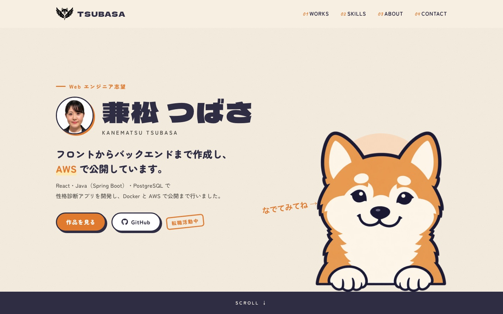
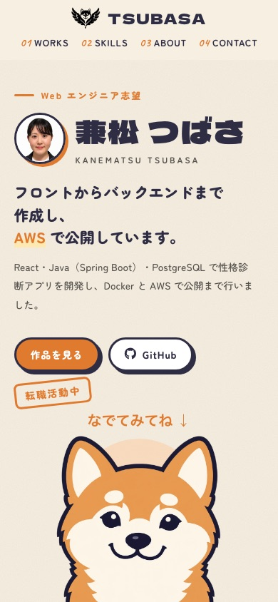
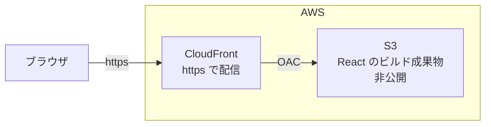

# Portfolio（兼松 つばさ）

Web エンジニアを目指して制作した作品をまとめた、転職活動用のポートフォリオサイトです。

## 概要

愛犬の柴犬をキャラクター化し案内役にしたデザインで、制作した作品・スキル・プロフィールを紹介しています。

React・TypeScript・Vite で作成し、AWS（S3 + CloudFront）で公開しています。

https://d2sawhxyg8rub9.cloudfront.net

| PC | スマートフォン |
| --- | --- |
|  |  |

以下のセクションで構成しています。

- トップ（名前・ひとこと・愛犬のキャラクター化）
- WORKS（制作した作品。メインの作品は動画・主な機能・工夫したこと・システム構成図つき）
- SKILLS（分野ごとの技術と、どこで使ったか）
- ABOUT（プロフィール・現職の業務）
- CONTACT（メール・GitHub）

## 掲載している作品

| 作品 | 技術 | 公開URL |
| --- | --- | --- |
| あなたをわんこに例えると？（性格診断アプリ） | React / TypeScript / Java / Spring Boot / PostgreSQL / Docker / AWS | https://d330uf5f2vl9lz.cloudfront.net |
| 検索ページ 模写 | HTML / CSS / JavaScript | https://k-tsubasa2026.github.io/google-demo/ |
| EC サイト ヘッダー模写 | HTML / CSS / JavaScript | https://k-tsubasa2026.github.io/amazon-demo/ |
| マンガサイト 模写 | React / TypeScript / Vite | https://k-tsubasa2026.github.io/kadocomi-demo/ |

## 使用技術

### フロントエンド

- React 19
- TypeScript
- Vite
- CSS（コンポーネントごとにファイルを分割）
- [Font Awesome](https://fontawesome.com/)（アイコン）
- Google Fonts（Dela Gothic One・Zen Maru Gothic・Caveat）

### 開発ツール

- oxlint（コードのチェック）

### インフラ

- AWS S3（ビルドしたファイルの置き場）
- AWS CloudFront（https での配信）

## システム構成



S3 のバケットは公開せず、CloudFront の OAC（Origin Access Control）を使って、CloudFront からだけ読み取れるようにしています。

- S3 だけで公開すると http になるため、CloudFront を前に置いて https で配信する
- 入り口を CloudFront の1つにして、S3 のファイルが直接見られないようにする
- CloudFront の配信拠点（エッジ）から届けることで、表示を速くする
- S3 から CloudFront への転送は無料のため、料金をおさえられる

## ディレクトリ構成

```text
portfolio/
├── docs/
│   └── images/          # README 用の画像
├── public/              # そのまま公開されるファイル
│   ├── images/          # 作品カードの画像
│   ├── shiba/           # 柴犬の画像（通常・笑顔・目を閉じる）
│   └── videos/          # 作品紹介の動画
├── src/
│   ├── components/      # 画面の部品
│   ├── data/
│   │   └── works.ts     # 作品の情報
│   ├── hooks/
│   │   └── useInView.ts # 画面に入ったかどうかを調べるフック
│   ├── App.tsx
│   ├── index.css        # 色・フォント・共通の見た目
│   └── main.tsx
├── index.html
└── package.json
```

## 工夫した点

### 柴犬キャラクターのアニメーション

表情だけを変えた同じ構図の画像を3枚（通常・笑顔・目を閉じる）重ね、表示する画像を CSS で切りかえて動きを作っています。

- ページを開くと、手すりの下からひょっこり顔を出す
- 一定の間隔でまばたきをし、息をするようにゆっくりふくらむ
- クリックすると笑顔になって弾み、ふきだしでセリフを話す

アニメーションのライブラリは使わず、CSS の `@keyframes` と `transition` だけで作っています。

### 画面に入ったときのアニメーション

`IntersectionObserver` を使ったカスタムフック `useInView` と、それを使う `Reveal` コンポーネントを作り、見出しやカードが画面に入ったときに下からふわっと表示されるようにしています。

縦に長い要素は「何％見えたら」という判定だとスマートフォンで表示されないことがあるため、`rootMargin` を使って「画面の下から 15% 入ったら」表示する判定にしています。

### 動きを減らす設定への対応

OS の「視差効果を減らす」（`prefers-reduced-motion`）がオンの場合は、アニメーションを止めて、最初から完成した状態で表示します。

そのため、CSS はふだんの見た目を完成形にしておき、アニメーションは「消えた状態から完成形へ」だけを書くようにしています。

### 作品の情報をデータとして管理

作品の情報は `src/data/works.ts` に配列でまとめ、`map()` で並べています。作品を追加するときは、ここにデータを足すだけでカードが増えます。

### 画像の軽量化

画像は WebP 形式に変換し、表示サイズに合わせて縮小しています。柴犬の画像は3枚で約 2.8MB から約 220KB になりました。

### レスポンシブ対応

画面幅に合わせてレイアウトを切りかえています（PC・タブレット・スマートフォン）。スマートフォンでは、文章が言葉の途中で改行されないように調整しています。

## ローカルでの確認方法

事前に Node.js をインストールしておく必要があります（v24 で動作を確認しています）。

```bash
# リポジトリをダウンロード
git clone https://github.com/K-Tsubasa2026/portfolio.git

# フォルダに移動
cd portfolio

# パッケージをインストール
npm install

# 開発用サーバーを起動
npm run dev
```

起動後、以下の URL から確認できます。

```text
http://localhost:5173/
```

| コマンド | 内容 |
| --- | --- |
| `npm run dev` | 開発用サーバーを起動 |
| `npm run build` | 型チェックをしてから、公開用のファイルを `dist` に作成 |
| `npm run lint` | oxlint でコードをチェック |
| `npm run preview` | ビルドしたファイルを手元で確認 |

## 公開の手順

1. `npm run build` で `dist` フォルダを作成する
2. `dist` フォルダの中身を S3 のバケットにアップロードする
3. CloudFront で `/index.html` のキャッシュを削除（Invalidation）する

`index.html` はファイル名が変わらないため、キャッシュを削除しないと古い画面が表示され続けます。JavaScript・CSS はビルドのたびにファイル名が変わるため、削除は不要です。

## 注意事項

本プロジェクトは、個人の学習・転職活動を目的として作成したものです。

模写の作品は学習用に既存のサイトを再現したもので、ロゴや画像は自作のものに差し替えています。
